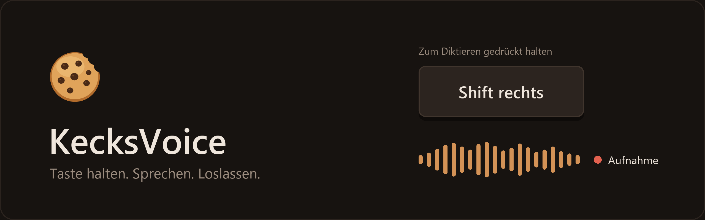
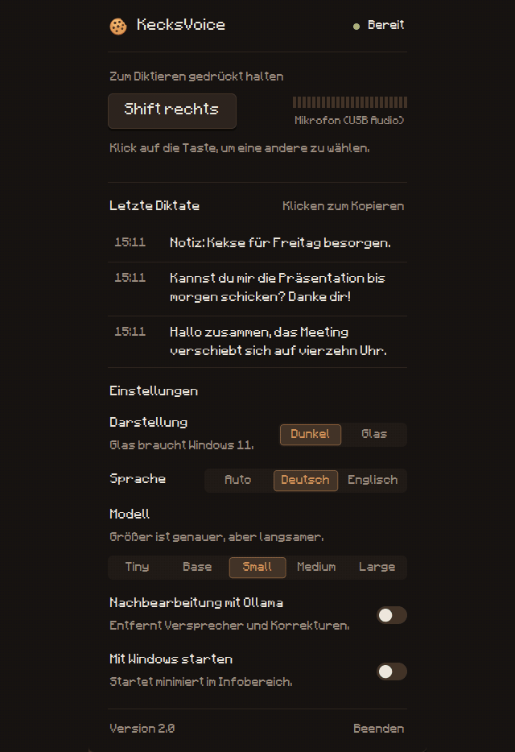
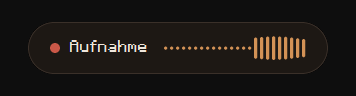
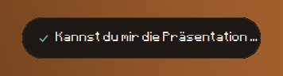
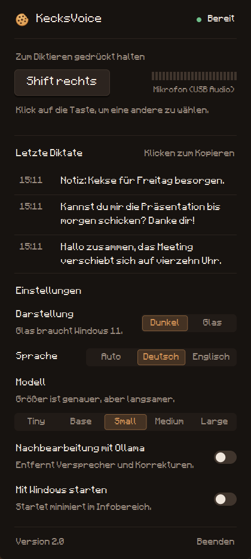
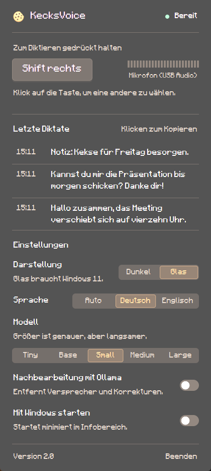

<p align="center">
  
</p>

<p align="center">
  <b>Diktieren in jedes Programm. Lokal auf deinem PC, ohne Cloud und ohne Konto.</b>
</p>

<p align="center">
  
  
  
  
  <a href="https://github.com/KecksKruemmel/kecks-voice/stargazers"></a>
  <a href="https://github.com/KecksKruemmel/kecks-voice/releases"></a>
  <a href="https://github.com/KecksKruemmel/kecks-voice/releases/latest"></a>
  <a href="https://discord.gg/bPB3p9ranD"></a>
</p>

<p align="center">
  
</p>

<br>

## So funktioniert es

<table>
  <tr>
    <td width="33%" align="center"><h3>1</h3><b>Taste halten</b><br><sub>Zum Beispiel Shift rechts. Die Taste ist frei wählbar.</sub></td>
    <td width="33%" align="center"><h3>2</h3><b>Sprechen</b><br><sub>Unten am Bildschirm zeigt eine kleine Anzeige deinen Pegel.</sub></td>
    <td width="33%" align="center"><h3>3</h3><b>Loslassen</b><br><sub>Der Text landet sofort im aktiven Fenster.</sub></td>
  </tr>
</table>

<p align="center">
  
  &nbsp;
  
</p>

## Zwei Looks

<table>
  <tr>
    <td align="center" width="50%"><br><sub><b>Dunkel</b></sub></td>
    <td align="center" width="50%"><br><sub><b>Glas</b> mit dem Acrylic Hintergrund von Windows 11</sub></td>
  </tr>
</table>

<p align="center"><sub>Umschalten unter <i>Einstellungen</i> und <i>Darstellung</i>. Der Wechsel passiert sofort.</sub></p>

## Was drin steckt

<table>
  <tr>
    <td width="50%" valign="top"><b>Komplett lokal</b><br>Die Spracherkennung läuft mit <a href="https://github.com/SYSTRAN/faster-whisper">Faster Whisper</a> auf deiner CPU. Kein Audio verlässt den PC.</td>
    <td width="50%" valign="top"><b>Fügt überall ein</b><br>Word, Discord, Browser, Code Editor. Deine Zwischenablage bleibt dabei erhalten.</td>
  </tr>
  <tr>
    <td valign="top"><b>Räumt automatisch auf</b><br>Füllwörter wie „äh“ und „ähm“ werden entfernt, der Satz beginnt groß.</td>
    <td valign="top"><b>Optionale Nachbearbeitung</b><br>Ein lokales <a href="https://ollama.com">Ollama</a> Modell glättet Versprecher und Selbstkorrekturen.</td>
  </tr>
  <tr>
    <td valign="top"><b>Live Pegelanzeige</b><br>Du siehst jederzeit, ob dein Mikrofon etwas hört und welches gerade aktiv ist.</td>
    <td valign="top"><b>Verlauf</b><br>Die letzten Diktate stehen im Fenster. Ein Klick kopiert sie erneut.</td>
  </tr>
  <tr>
    <td valign="top"><b>Läuft im Hintergrund</b><br>Symbol im Infobereich, auf Wunsch Start mit Windows.</td>
    <td valign="top"><b>Deutsch und Englisch</b><br>Feste Sprache oder automatische Erkennung.</td>
  </tr>
</table>

## Schnellstart

<p align="center">
  <a href="https://github.com/KecksKruemmel/kecks-voice/releases/latest/download/KecksVoice-Setup-2.0.exe"></a>
</p>

**So installierst du es:**
1. [KecksVoice-Setup-2.0.exe](https://github.com/KecksKruemmel/kecks-voice/releases/latest/download/KecksVoice-Setup-2.0.exe) herunterladen und doppelklicken.
2. Die Installation läuft ohne Administrator-Rechte. Sprache wählen, Weiter, Installieren.
3. Fertig. KecksVoice startet am Ende automatisch.

Kein Python nötig, nur Windows 10 oder 11 und ein Mikrofon. Beim ersten Start lädt die App das Sprachmodell einmalig herunter.

> **Windows blockiert den Installer?** Das passiert, weil die App noch nicht digital signiert ist. Bei der normalen SmartScreen-Warnung klickst du auf **Weitere Informationen** und dann auf **Trotzdem ausführen**. Wenn **Smart App Control** den Installer blockiert, gibt es diesen Knopf nicht. Dann hilft nur, Smart App Control unter *Windows-Sicherheit → App- und Browsersteuerung* auszuschalten (eine Sicherheitseinstellung, die Windows danach nur mit Neuinstallation wieder einschaltet). Alternativ kannst du den Quellcode selbst starten (siehe „Aus dem Quellcode“).

Ältere Versionen und die portable Variante findest du unter [Releases](https://github.com/KecksKruemmel/kecks-voice/releases).

### Aus dem Quellcode

Du brauchst Windows 10 oder 11, Python 3.10 oder neuer und ein Mikrofon.

```bat
git clone https://github.com/KecksKruemmel/kecks-voice.git
cd kecks-voice
python -m pip install -r requirements.txt
python kecksvoice.py
```

Beim ersten Start lädt die App das Sprachmodell einmalig herunter. Danach funktioniert alles offline.

### EXE selbst bauen

```bat
build.bat
```

Den Installer baust du mit Inno Setup 7 aus `installer\KecksVoice.iss`. Ergebnis: `installer\out\KecksVoice-Setup-2.0.exe`.

Danach liegt `dist\KecksVoice.exe` bereit. Auf dem Zielrechner wird kein Python gebraucht.

## Abhängigkeiten

<p align="center">
  
  
  
</p>

Alle Pakete installierst du mit einem Befehl aus `requirements.txt`:

```bat
python -m pip install -r requirements.txt
```

<table>
  <tr>
    <th align="left">Paket</th>
    <th align="left">Aufgabe in KecksVoice</th>
    <th align="left">Lizenz</th>
  </tr>
  <tr>
    <td><a href="https://pypi.org/project/faster-whisper/"><b>faster-whisper</b></a></td>
    <td>Spracherkennung, läuft offline auf der CPU</td>
    <td>MIT</td>
  </tr>
  <tr>
    <td><a href="https://pypi.org/project/sounddevice/"><b>sounddevice</b></a></td>
    <td>Mikrofon-Aufnahme</td>
    <td><sub>siehe Projektseite</sub></td>
  </tr>
  <tr>
    <td><a href="https://pypi.org/project/numpy/"><b>numpy</b></a></td>
    <td>Pegel und Audio-Daten</td>
    <td><sub>siehe Projektseite</sub></td>
  </tr>
  <tr>
    <td><a href="https://pypi.org/project/keyboard/"><b>keyboard</b></a></td>
    <td>Globale Taste zum Diktieren</td>
    <td>MIT</td>
  </tr>
  <tr>
    <td><a href="https://pypi.org/project/pyperclip/"><b>pyperclip</b></a></td>
    <td>Text in die Zwischenablage</td>
    <td>BSD</td>
  </tr>
  <tr>
    <td><a href="https://pypi.org/project/pystray/"><b>pystray</b></a></td>
    <td>Symbol im Infobereich</td>
    <td>LGPLv3</td>
  </tr>
  <tr>
    <td><a href="https://pypi.org/project/pillow/"><b>pillow</b></a></td>
    <td>Bilder für Anzeige und Symbol</td>
    <td><sub>siehe Projektseite</sub></td>
  </tr>
</table>

<sub>Zum Bauen der EXE brauchst du zusätzlich `pyinstaller` (siehe `build.bat`).</sub>

## Bedienung

<table>
  <tr><td><b>Diktieren</b></td><td>Taste halten, sprechen, loslassen</td></tr>
  <tr><td><b>Taste ändern</b></td><td>Auf die Tastenkappe klicken und die neue Taste drücken. Esc bricht ab.</td></tr>
  <tr><td><b>Erneut kopieren</b></td><td>Im Verlauf auf einen Eintrag klicken</td></tr>
  <tr><td><b>Fenster schließen</b></td><td>Die App läuft im Infobereich weiter. <i>Beenden</i> schließt sie ganz.</td></tr>
</table>

## Modelle

<table>
  <tr><th align="left">Modell</th><th align="left">Tempo</th><th align="left">Genauigkeit</th></tr>
  <tr><td>Tiny, Base</td><td>sehr schnell</td><td>solide</td></tr>
  <tr><td><b>Small</b> (Standard)</td><td>schnell</td><td>gut</td></tr>
  <tr><td>Medium</td><td>langsamer</td><td>sehr gut</td></tr>
  <tr><td>Large</td><td>langsam</td><td>am besten</td></tr>
</table>

## Nachbearbeitung mit Ollama

1. [Ollama](https://ollama.com) installieren
2. Modell holen: `ollama pull llama3.2`
3. In KecksVoice *Nachbearbeitung mit Ollama* einschalten

Aus „Wir treffen uns um drei, nein, um vier“ wird dann „Wir treffen uns um vier.“

## Einstellungen

Alles wird automatisch in `kecksvoice.json` neben der App gespeichert:

```json
{
  "hotkey": "right shift",
  "model": "small",
  "language": "de",
  "ollama": false,
  "ollama_model": "llama3.2",
  "autostart": false,
  "theme": "dark"
}
```

## Datenschutz

<table>
  <tr><td>Audio</td><td>bleibt auf deinem PC und wird nie gespeichert</td></tr>
  <tr><td>Verlauf</td><td>existiert nur im Arbeitsspeicher und ist nach dem Beenden weg</td></tr>
  <tr><td>Internet</td><td>nur für den einmaligen Modell Download und, falls aktiviert, Ollama auf <code>localhost</code></td></tr>
</table>

## Hilfe und Community

Fragen, Fehler oder Ideen? Auf dem [Kecks Support-Discord](https://discord.gg/bPB3p9ranD) hat KecksVoice ein eigenes Forum. Dort gibt es auch Update-Benachrichtigungen zu neuen Versionen und private Tickets.

## Lizenz

[MIT](LICENSE)

<br>

<p align="center">
  <br>
  <sub>Gebaut von Kecks</sub>
</p>
