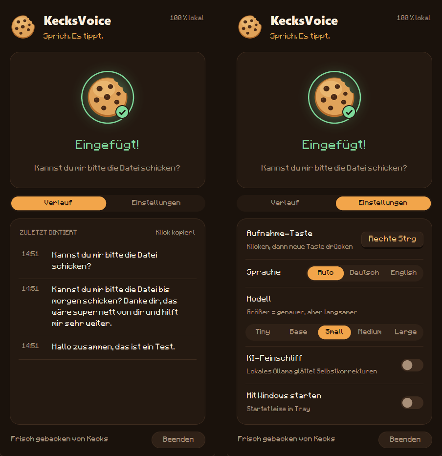

<div align="center">

# 🍪 KecksVoice

**Sprich. Es tippt.**

Lokales Push-to-Talk-Diktieren für Windows. Taste halten, sprechen, loslassen,
und der Text landet im aktiven Fenster. Ohne Cloud, ohne Konto, ohne API-Key.



</div>

## Funktionen

- **Push-to-Talk:** frei wählbare Taste, zum Beispiel die rechte Shift-Taste.
- **100 % lokale Spracherkennung** mit [faster-whisper](https://github.com/SYSTRAN/faster-whisper) auf der CPU.
- **Fügt direkt ein:** in jedes Programm, die Zwischenablage bleibt erhalten.
- **Räumt auf:** Füllwörter wie „äh“ und „ähm“ fliegen raus.
- **Optionaler KI-Feinschliff:** Ein lokales [Ollama](https://ollama.com)-Modell glättet Selbstkorrekturen.
- **Schwebendes Overlay** mit Live-Wellenform während der Aufnahme.
- **Verlauf:** Ein Klick kopiert einen früheren Text erneut.
- **Tray-Icon und Autostart:** läuft unauffällig im Hintergrund.
- Deutsch, Englisch oder automatische Spracherkennung.

## Schnellstart

Voraussetzungen: Windows 10/11, Python 3.10+ und ein Mikrofon.

```bat
git clone https://github.com/<dein-name>/kecks-voice.git
cd kecks-voice
python -m pip install -r requirements.txt
python kecksvoice.py
```

Beim ersten Start lädt faster-whisper das gewählte Modell einmalig von Hugging Face herunter.
Danach läuft alles offline.

### Als EXE bauen

```bat
build.bat
```

Danach liegt `dist\KecksVoice.exe` bereit. Die Datei braucht kein installiertes Python.

## Bedienung

| Aktion | So geht's |
|---|---|
| Diktieren | Aufnahme-Taste **halten**, sprechen, **loslassen** |
| Taste ändern | *Einstellungen → Aufnahme-Taste* anklicken, neue Taste drücken (Esc bricht ab) |
| Text erneut kopieren | Im *Verlauf* auf einen Eintrag klicken |
| Fenster schließen | Die App läuft im Tray weiter; *Beenden* schließt sie ganz |

### Modelle

| Modell | Geschwindigkeit | Genauigkeit |
|---|---|---|
| Tiny / Base | sehr schnell | okay |
| **Small** (Standard) | schnell | gut |
| Medium | langsamer | sehr gut |
| Large | langsam | am besten |

### KI-Feinschliff (optional)

1. [Ollama](https://ollama.com) installieren.
2. Das Modell holen: `ollama pull llama3.2`.
3. In KecksVoice *KI-Feinschliff* einschalten.

Aus „Wir treffen uns um drei, nein, um vier“ wird dann „Wir treffen uns um vier.“

## Konfiguration

Die Einstellungen liegen in `kecksvoice.json` neben der App und werden automatisch angelegt:

```json
{
  "hotkey": "right ctrl",
  "model": "small",
  "language": "auto",
  "ollama": false,
  "ollama_model": "llama3.2",
  "autostart": false
}
```

## Datenschutz

- Audio verlässt nie deinen Rechner und wird nicht gespeichert.
- Der Verlauf existiert nur im Arbeitsspeicher und ist nach dem Beenden weg.
- Netzwerkzugriff gibt es nur beim einmaligen Modell-Download und, falls aktiviert, zu Ollama auf `localhost`.

## Lizenz

[MIT](LICENSE). Frisch gebacken von Kecks.
